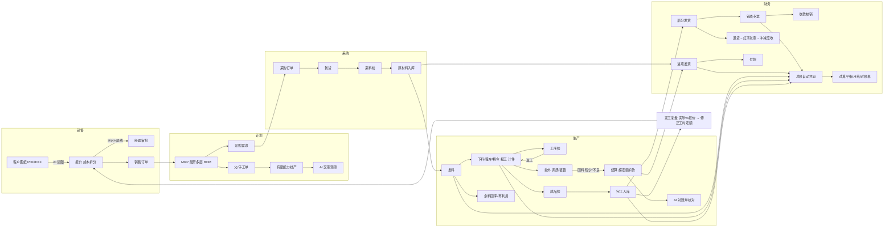

# 00 概要

## 1. 目的与范围

面向**中小机械加工 / 装配厂（按订单生产，MTO）**的 AI 原生 ERP。按日式「详细设计」一次覆盖全部业务，不分期；所有业务规则在 PostgreSQL 层用约束、触发器和函数实现，并用端到端剧本在 SQL 层真实跑通。

| 领域 | 覆盖内容 |
|---|---|
| 主数据 | 多租户、多工厂、仓库(原材料/半成品/成品/余料/不良/外协/在途)、客户/供应商/外协厂、员工、物料、参数模板(规格)、图纸版本、设备 |
| 技术 | 多层 BOM、工艺路线(厂内工序 + 委外工序)、图纸版本与 ECN |
| 销售 | AI 读图报价、成本拆分、毛利底线审批、销售订单、部分发货、退货 |
| 计划 | MRP 展开多层 BOM、自动生成父子工单、有限能力排产、AI 交期预测 |
| 采购 | 采购订单、到货、来料检、入库(不含税计价)、进项发票 |
| 生产 | 工单下达、发料、扫码报工、计件工资、机时成本、工序检、返工、成品检、完工入库、余料回库与再利用 |
| 委外 | 委外单、发料/回料(分批)、回料检验、损耗定额、超定额扣款、结算、AI 对账单核对 |
| 库存 | 移动加权平均、只增不改流水、作废冲销、多工厂调拨(经在途) |
| 财务 | 销项/进项增值税发票(专票/普票、价税分离、红字)、应收应付流水、收付款核销、总账自动凭证、试算平衡、月结关账、客户对账单 |
| AI | 读图报价、委外对账单核对、完工复盘修正工时定额、交期预测（输入输出与结果全部落表） |
| 治理 | 多租户 RLS、角色列权限(成本/毛利/工资)、审计日志、状态机 |

不做：对接税局开票（只提供 `v_invoice_export` 导出）、工资发放、固定资产、HR。

## 2. 角色

| 角色 | 数据库角色 | 主要职责 |
|---|---|---|
| 经理 | erp_manager | 审批低毛利报价、看全部成本与毛利 |
| 财务 | erp_finance | 发票、收付款、总账、月结 |
| 销售 | erp_sales | 报价、订单、发货、对账；**看不到成本与工资** |
| 计划/工艺 | erp_planner | BOM、工艺、MRP、排产、委外；看不到工资、毛利 |
| 操作工 | erp_operator | 扫码报工；看不到价格、成本、机时成本 |
| 质检 | erp_qc | 来料/工序/成品/委外检验 |

## 3. 业务全景

## 4. 设计原则

1. **SQL 是唯一真相**：状态迁移、数量守恒、借贷平衡、只增不改都写死在数据库层，应用层绕不过去。
2. **流水只增不改**：`stock_ledger`、`payment_ledger`、`gl_entry`、`journal_entry`、`job_card`、`wo_cost_entry`、`subcontract_movement`、`subcontract_settlement`、`audit_log` 禁止 UPDATE/DELETE；更正用冲销记录。
3. **参数与数据分离**：所有价格、费率、工价、工时、规则参数集中在 `ref_param`，每条都关联 `reference_source`（URL、查询日期、是否示例）。场景断言基于参数计算，不硬编码。
4. **AI 只给建议，人和规则做决定**：AI 输出落 `ai_request` 等表，报价审批、工时定额修改都要人工或规则确认。
5. **参考 ERPNext 的单据链和字段设计思路，不复制任何 GPL 代码**；规格参数参考 InvenTree 的参数模板思路，自行实现。

## 5. 文档目录

| 文件 | 内容 |
|---|---|
| 01_业务流程.md | 每条流程的时序图/状态图 |
| 02_画面功能一览.md | 画面与对应函数 |
| 03_数据字典.md | 每表每字段（自动生成） |
| 04_单据状态迁移表.md | 状态机（自动生成） |
| 05_权限矩阵.md | 角色 × 数据，RLS 与列权限 |
| 06_AI接口设计.md | 4 个 AI 接口的 JSON schema 与落表 |
| 07_测试场景与预期结果.md | 剧本与断言清单 |
