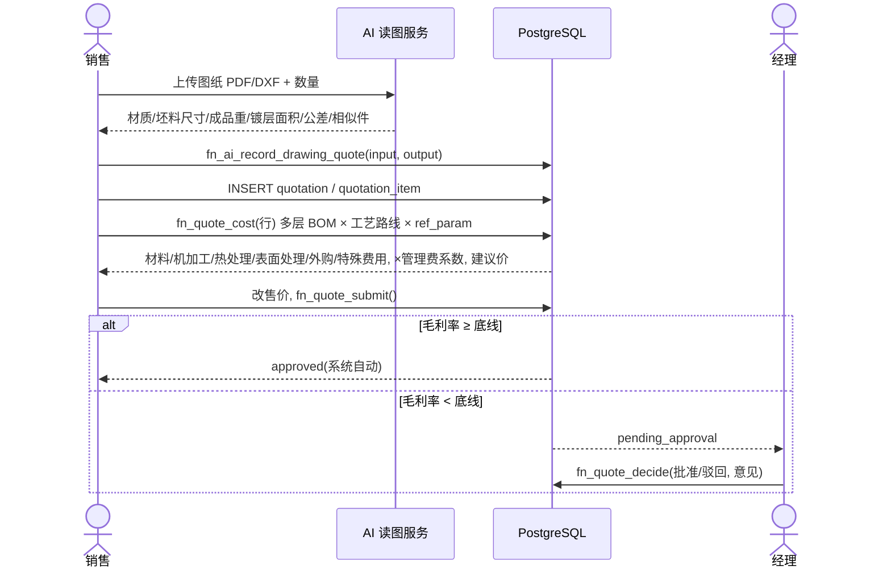
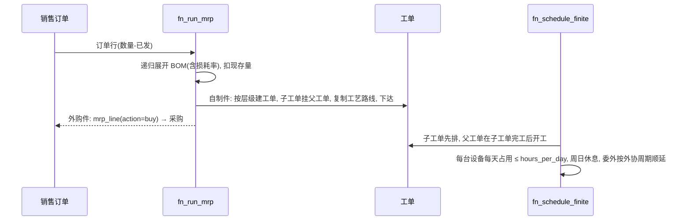
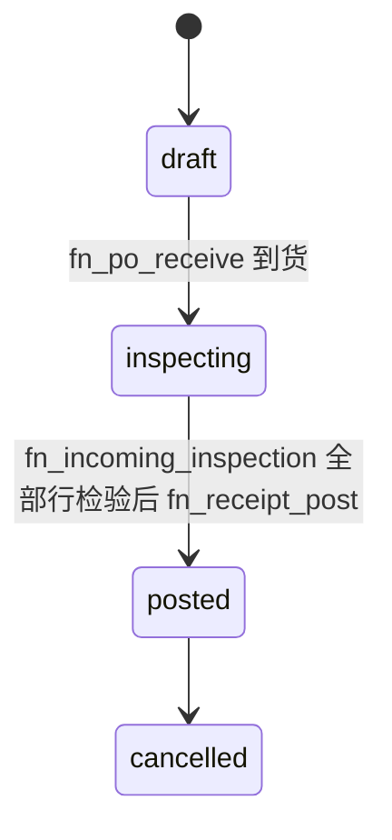
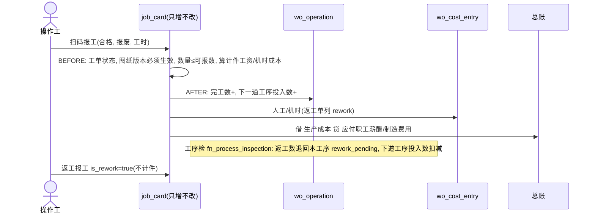
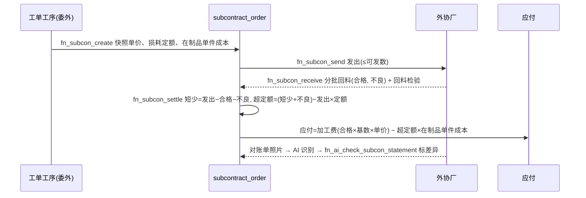
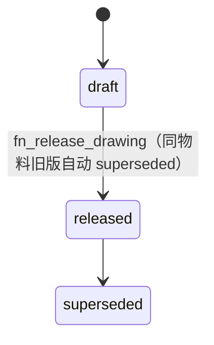
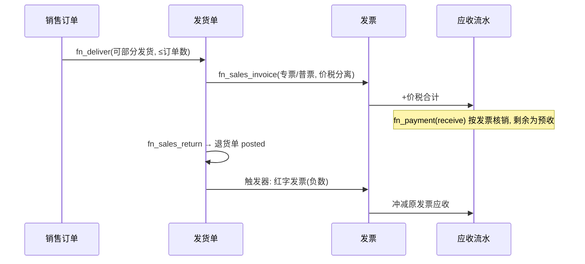

# 01 业务流程

每条流程列出参与者、关键函数和数据库层保证。函数位于 `db/functions/`。

## F01 读图报价与低毛利审批

报价公式（依据库卡竞价公告的计价口径）：
`单件成本 = (材料kg价×毛重 + Σ工时×设备费率 + 热处理费 + 表面处理费 + 外购件 + 特殊费用) × 管理费系数`，
`建议价 = 单件成本 / (1 − 毛利底线)`。

## F02 订单 → MRP → 工单 → 排产

## F03 采购 → 来料检 → 入库 → 进项发票

合格品按 `含税单价/(1+税率)` 入库（借 原材料 贷 应付暂估）；不合格品不入库并累计到 `rejected_qty`。进项发票 `fn_purchase_invoice`：借 应付暂估 + 进项税，贷 应付账款，同时写应付流水。

## F04 生产：发料 / 报工 / 工序检 / 返工 / 完工

工单数量守恒：`本工序可报 = 投入 − 完工 − 报废 − 待返工`。成品检 `fn_final_inspection` 后才能 `fn_wo_receive`，入库金额 = 工单累计成本按剩余可入库数分摊。

## F05 委外加工（调质、镀铬）

## F06 图纸变更（客户中途改图）

`fn_change_drawing` 发布新版、把未完结订单行和工单切到新版、写 ECN（受影响在制品数、处置意见）。之后按旧版报工会被 `trg_job_card_before` 拒绝（EP004）。

## F07 余料（边角料）

领料后按长度/直径/重量登记 `fn_return_remnant`：按本工单领料均价入余料仓，冲减工单材料成本（`remnant_credit`）。其他工单可用 `fn_reuse_remnant` 再领用，状态 available → reused，不能重复领用。

## F08 发货、开票、收款、退货

## F09 多工厂调拨

`fn_transfer_ship`：调出仓 → 在途仓（借 在途物资 贷 存货）；`fn_transfer_receive`：在途 → 调入仓。金额随货转移，在途科目最终为 0。

## F10 月结

1. `fn_customer_statement(客户, 期间)`：期初、本期发票/红票/收款、期末、已发货未开票。
2. `fn_close_period(期间)`：检查试算平衡、应收/应付总账与明细账一致，然后关账；关账后该期间不能再过账。

## F11 完工复盘

`v_order_cost_actual` 汇总订单实际成本（材料−余料冲减、人工、机时、委外−扣款、返工；半成品结转不重复计入），与报价单件成本对比。`fn_cost_review` 按 `新定额 = α×实际 + (1−α)×原定额` 给出建议，`fn_apply_cost_review` 人工确认后写回工艺路线，下一次 `fn_quote_cost` 自动使用。
