# 04 单据状态迁移表

> 自动生成自 `doc_state_rule`。表中未列出的迁移一律被触发器 `trg_state_machine` 拒绝（错误码 EP002）；
> 进入终态（cancelled/closed/posted/paid/settled 等）的单据内容不可再改（EP003）。流水表另由 `trg_append_only` 禁止 UPDATE/DELETE。

## ai_request

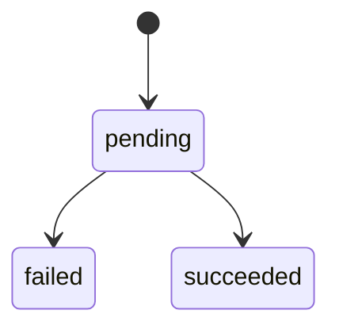

| 当前状态 | 可迁移到 |
|---|---|
| (新建) | pending |
| pending | failed, succeeded |

## delivery_note

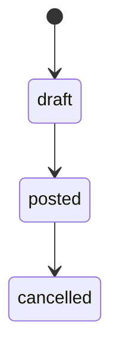

| 当前状态 | 可迁移到 |
|---|---|
| (新建) | draft |
| draft | posted |
| posted | cancelled |

## drawing_revision

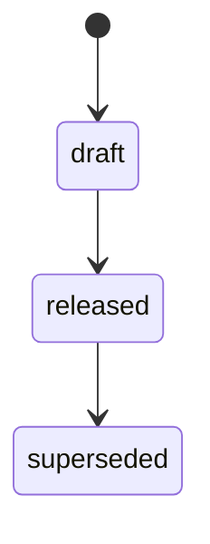

| 当前状态 | 可迁移到 |
|---|---|
| (新建) | draft |
| draft | released |
| released | superseded |

## invoice

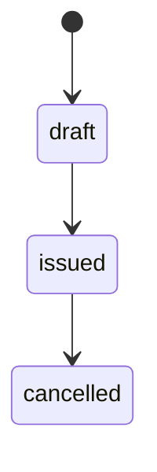

| 当前状态 | 可迁移到 |
|---|---|
| (新建) | draft |
| draft | issued |
| issued | cancelled |

## material_request

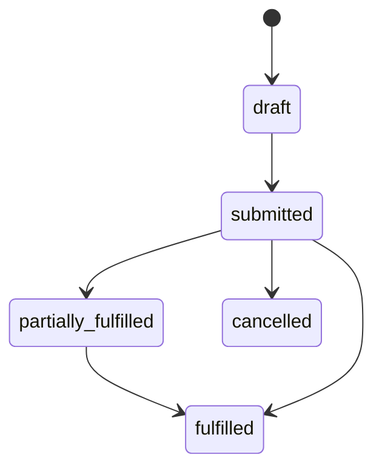

| 当前状态 | 可迁移到 |
|---|---|
| (新建) | draft |
| draft | submitted |
| partially_fulfilled | fulfilled |
| submitted | cancelled, fulfilled, partially_fulfilled |

## payment_entry

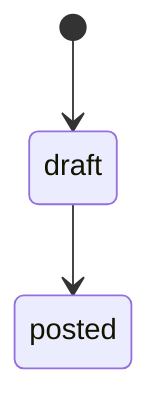

| 当前状态 | 可迁移到 |
|---|---|
| (新建) | draft |
| draft | posted |

## production_plan

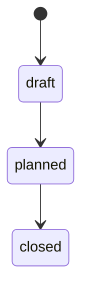

| 当前状态 | 可迁移到 |
|---|---|
| (新建) | draft |
| draft | planned |
| planned | closed |

## purchase_order

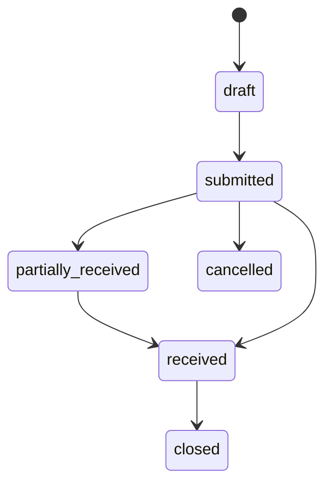

| 当前状态 | 可迁移到 |
|---|---|
| (新建) | draft |
| draft | submitted |
| partially_received | received |
| received | closed |
| submitted | cancelled, partially_received, received |

## purchase_receipt

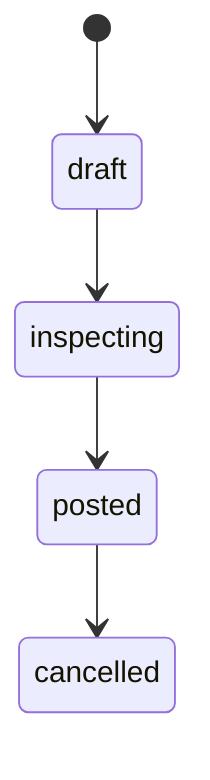

| 当前状态 | 可迁移到 |
|---|---|
| (新建) | draft |
| draft | inspecting |
| inspecting | posted |
| posted | cancelled |

## quality_inspection

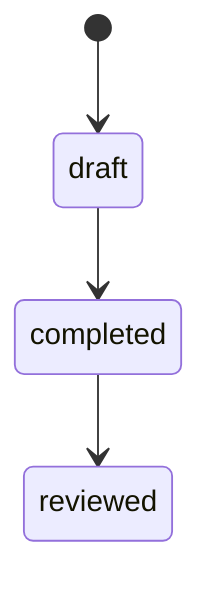

| 当前状态 | 可迁移到 |
|---|---|
| (新建) | draft |
| completed | reviewed |
| draft | completed |

## quotation

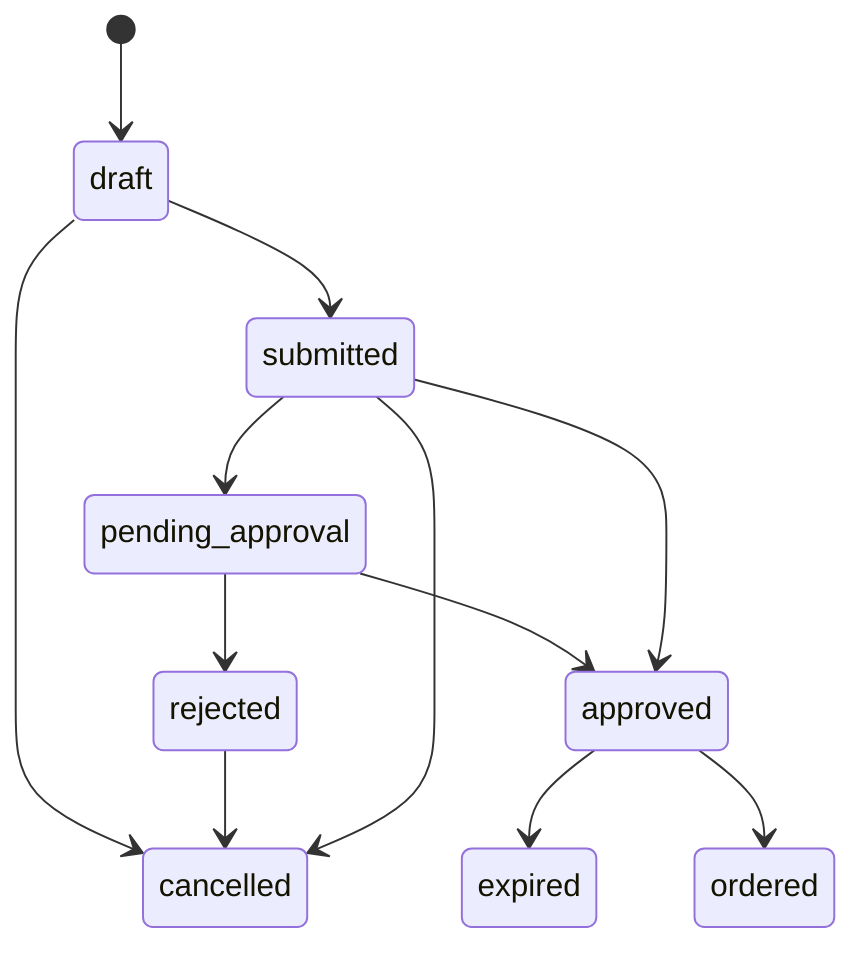

| 当前状态 | 可迁移到 |
|---|---|
| (新建) | draft |
| approved | expired, ordered |
| draft | cancelled, submitted |
| pending_approval | approved, rejected |
| rejected | cancelled |
| submitted | approved, cancelled, pending_approval |

## remnant

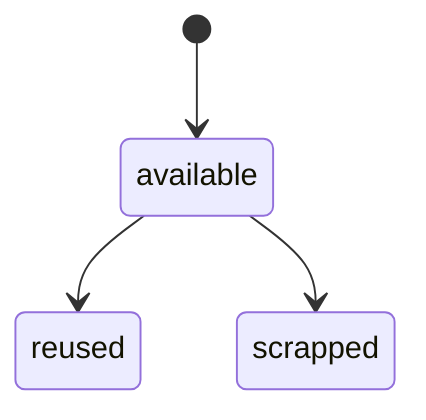

| 当前状态 | 可迁移到 |
|---|---|
| (新建) | available |
| available | reused, scrapped |

## sales_order

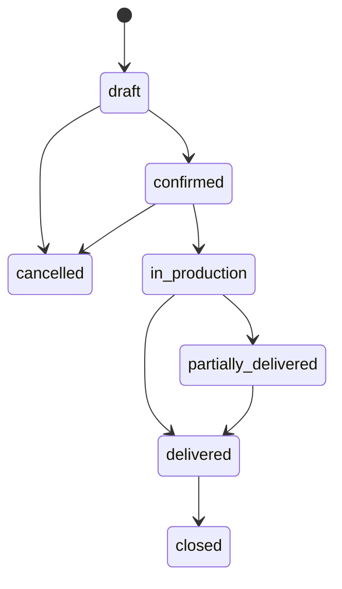

| 当前状态 | 可迁移到 |
|---|---|
| (新建) | draft |
| confirmed | cancelled, in_production |
| delivered | closed |
| draft | cancelled, confirmed |
| in_production | delivered, partially_delivered |
| partially_delivered | delivered |

## serial_no

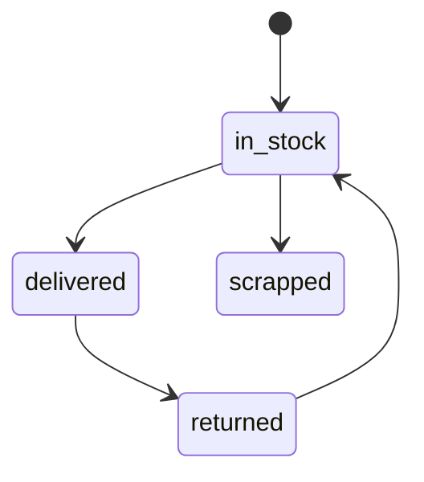

| 当前状态 | 可迁移到 |
|---|---|
| (新建) | in_stock |
| delivered | returned |
| in_stock | delivered, scrapped |
| returned | in_stock |

## stock_transfer

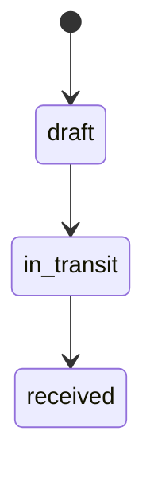

| 当前状态 | 可迁移到 |
|---|---|
| (新建) | draft |
| draft | in_transit |
| in_transit | received |

## subcontract_order

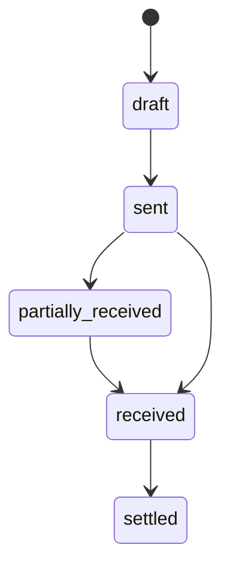

| 当前状态 | 可迁移到 |
|---|---|
| (新建) | draft |
| draft | sent |
| partially_received | received |
| received | settled |
| sent | partially_received, received |

## wo_operation

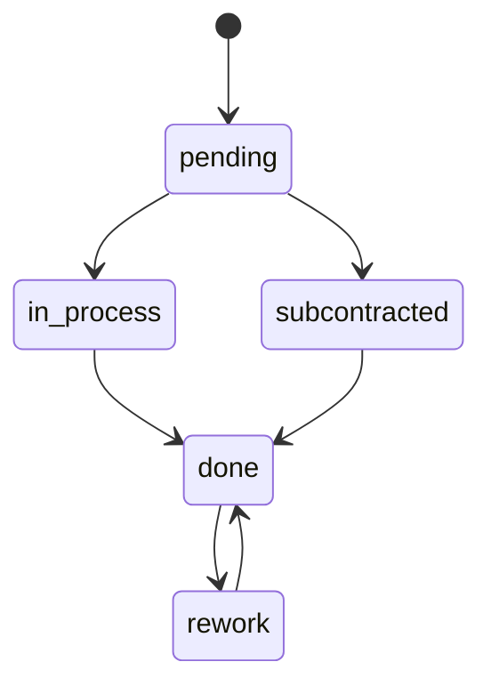

| 当前状态 | 可迁移到 |
|---|---|
| (新建) | pending |
| done | rework |
| in_process | done |
| pending | in_process, subcontracted |
| rework | done |
| subcontracted | done |

## work_order

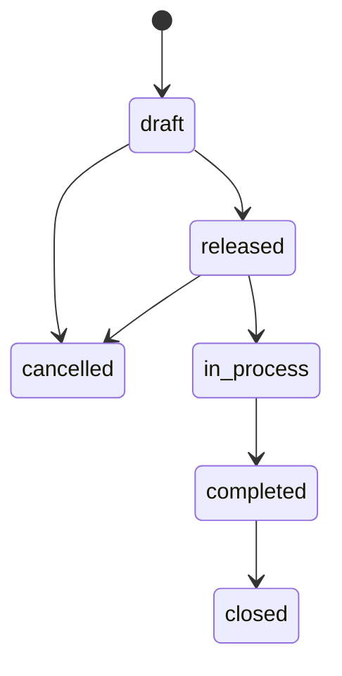

| 当前状态 | 可迁移到 |
|---|---|
| (新建) | draft |
| completed | closed |
| draft | cancelled, released |
| in_process | completed |
| released | cancelled, in_process |
